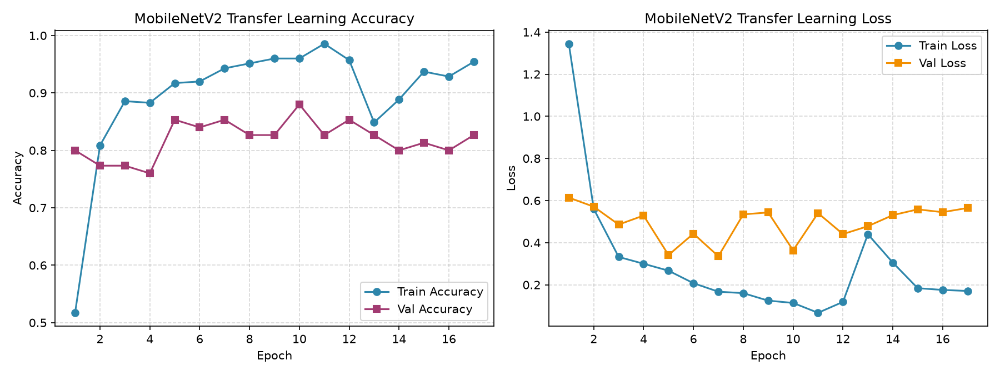
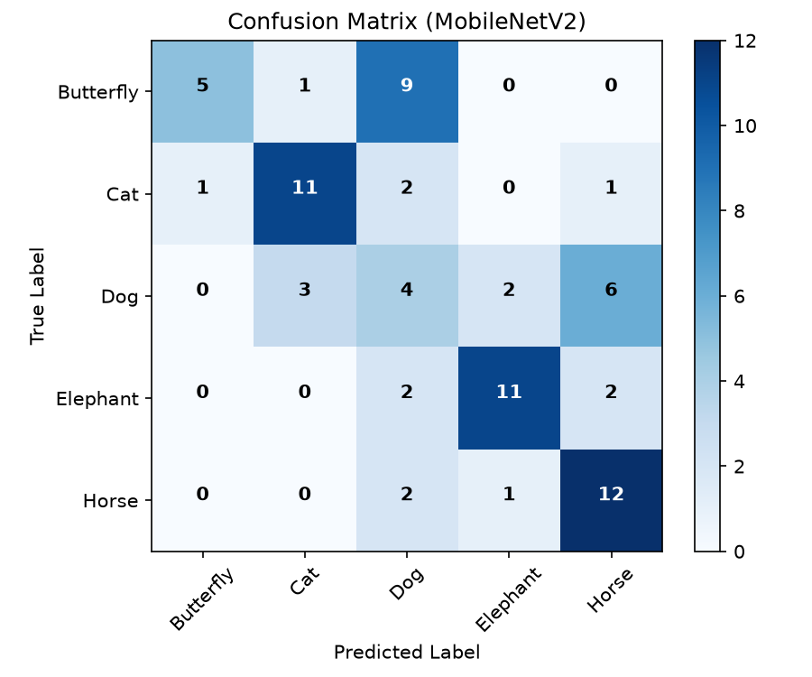

# Multi-Class Animal Image Classification with MobileNetV2

An end-to-end computer vision and deep learning application that classifies natural animal images into five categories using **MobileNetV2 Transfer Learning**. Built with TensorFlow/Keras and deployed as an interactive web application using Streamlit, this project demonstrates production-ready ML engineering practices including in-model data augmentation, two-stage fine-tuning, strict three-way dataset isolation, and objective model diagnostics.

---

## 🏷️ Technology Badges


---

## 🌐 Live Application

[](https://share.streamlit.io/)

> **Live Demo:** Deployable with 1-click on [Streamlit Community Cloud](https://share.streamlit.io/) directly from this repository. Local preview available instantly via `python -m streamlit run app.py`.

---

## ✨ Key Features

- **Pre-trained Deep Feature Extraction:** Employs MobileNetV2 with ImageNet weights to extract high-level visual representations from low-data regimes.
- **Two-Stage Transfer Learning:** Combines frozen feature extraction (`Adam`, $lr=10^{-3}$) with top-layer fine-tuning (`Adam`, $lr=10^{-4}$) governed by `EarlyStopping`.
- **In-Model Preprocessing & Augmentation:** Embedded layers for random horizontal flipping, rotation, zoom, and $[-1, 1]$ rescaling run seamlessly on GPU/CPU without external pipelines.
- **Strict 3-Way Dataset Isolation:** Separated training (350), validation (75), and testing (75) sets ensure zero data leakage across evaluation phases.
- **Perceptual Deduplication:** Dataset cleaned using Difference Hashing (`dhash`) to prevent duplicate images and near-identical angles from biasing metrics.
- **Interactive Streamlit Web Interface:** Allows instant drag-and-drop image uploads (`JPG`, `PNG`, `WEBP`) or 1-click selection from bundled test set samples.
- **Real-Time Probability Breakdown:** Displays top predicted class, confidence percentage, and horizontal probability progress bars across all five categories.
- **Dual Inference Interface:** Includes both an interactive Streamlit UI ([app.py](file:///c:/Users/HP/OneDrive/Desktop/Multi-Class%20Animal%20Image%20Classification/app.py)) and an automated CLI utility ([predict.py](file:///c:/Users/HP/OneDrive/Desktop/Multi-Class%20Animal%20Image%20Classification/predict.py)).
- **Comprehensive Diagnostic Reports:** Automatically plots and updates learning curves and a scikit-learn confusion matrix heatmap.

---

## 📸 Application Preview & Visual Diagnostics

| Training & Validation Learning Curves | Confusion Matrix (Test Set Evaluation) |
| :---: | :---: |
|  |  |
| *Evolution of Loss and Accuracy across Training & Validation* | *Actual vs. Predicted class distribution on 75 unseen samples* |

### Streamlit Web Interface Overview
```text
+-----------------------------------------------------------------------+
|  🐾 Multi-Class Animal Image Classification                           |
|  Upload an image of an animal to predict its category using           |
|  MobileNetV2 Transfer Learning (CNN).                                 |
+-----------------------------------+-----------------------------------+
|  [ Input Image Preview ]          |  [ Prediction Result ]            |
|                                   |  ✔ Predicted Animal: Cat          |
|                                   |  Confidence: 99.99%               |
|                                   |                                   |
|                                   |  Probability Breakdown:           |
|                                   |  - Cat:        99.99% [████████]  |
|                                   |  - Butterfly:   0.01% [        ]  |
|                                   |  - Dog:         0.00% [        ]  |
|                                   |  - Elephant:    0.00% [        ]  |
|                                   |  - Horse:       0.00% [        ]  |
+-----------------------------------+-----------------------------------+
|  📊 [Expandable] Model Diagnostics: Confusion Matrix & Curves         |
+-----------------------------------------------------------------------+
```

---

## ⚙️ How the Project Works

```
 Raw Image (.jpg / .png)
        │
        ▼
 ┌──────────────────────────────────────────────┐
 │ Preprocessing & Resizing (128x128x3)         │
 └──────────────────────┬───────────────────────┘
                        │
                        ▼
 ┌──────────────────────────────────────────────┐
 │ In-Model Normalization: [-1, 1]              │
 └──────────────────────┬───────────────────────┘
                        │
                        ▼
 ┌──────────────────────────────────────────────┐
 │ MobileNetV2 Base (Pretrained ImageNet)       │
 │ Output: 4x4x1280 feature maps                │
 └──────────────────────┬───────────────────────┘
                        │
                        ▼
 ┌──────────────────────────────────────────────┐
 │ Global Average Pooling 2D (1280 features)    │
 └──────────────────────┬───────────────────────┘
                        │
                        ▼
 ┌──────────────────────────────────────────────┐
 │ Dropout (0.3) -> Dense (128, ReLU) -> (0.3)  │
 └──────────────────────┬───────────────────────┘
                        │
                        ▼
 ┌──────────────────────────────────────────────┐
 │ Softmax Output Layer (5 Animal Classes)      │
 └──────────────────────┬───────────────────────┘
                        │
                        ▼
 Prediction: Category Name & Confidence Score (%)
```

1. **Input Ingestion:** The user uploads an image via Streamlit or specifies a path via the command line.
2. **Standardization:** The image is converted to 3-channel RGB and resized to $128 \times 128$.
3. **In-Model Scaling:** The model's internal `Rescaling` layer maps raw $[0, 255]$ pixel values to $[-1, 1]$.
4. **Feature Extraction:** Depthwise separable convolutions in MobileNetV2 extract complex spatial features.
5. **Dimensionality Reduction:** `GlobalAveragePooling2D` flattens the $4 \times 4 \times 1280$ activation volume to a 1,280-dimensional feature vector.
6. **Classification & Softmax:** Fully connected dense layers with dropout output normalized probability scores for all five animal categories.

---

## 🧠 MobileNetV2 Transfer Learning Architecture

```text
Model: "mobilenetv2_animal_classifier"
_________________________________________________________________
 Layer (type)                Output Shape              Param #   
=================================================================
 input_layer (InputLayer)    (None, 128, 128, 3)       0         
 data_augmentation (Seq)     (None, 128, 128, 3)       0         
 rescaling (Rescaling)       (None, 128, 128, 3)       0         
 mobilenetv2_1.00_128 (Func) (None, 4, 4, 1280)        2,257,984 
 global_average_pooling2d    (None, 1280)              0         
 dropout (Dropout 0.3)       (None, 1280)              0         
 dense (Dense 128, ReLU)     (None, 128)               163,968   
 dropout_1 (Dropout 0.3)     (None, 128)               0         
 dense_1 (Dense 5, Softmax)  (None, 5)                 645       
=================================================================
Total params: 2,422,597 (9.24 MB)
Trainable params (Phase 1): 164,613 (643.02 KB)
Trainable params (Phase 2): 736,005 (2.81 MB)
Non-trainable params (Base): 1,686,592 (6.43 MB)
_________________________________________________________________
```

### Training Strategy
- **Phase 1 (Feature Extraction):** The MobileNetV2 base is frozen (`trainable = False`), running in inference mode (`training = False`) to keep batch normalization moving statistics intact. The classification head is trained for 12 epochs using Adam ($lr = 0.001$).
- **Phase 2 (Fine-Tuning):** The top 25 convolutional layers of MobileNetV2 are unfrozen. The model is trained with a low learning rate ($lr = 10^{-4}$) and `EarlyStopping` monitoring validation loss (`patience = 4`, `restore_best_weights = True`).

---

## 📊 Dataset & Categories

The project classifies five distinct animal classes:
1. 🐱 **Cat** (*Felis catus*)
2. 🐶 **Dog** (*Canis familiaris*)
3. 🐘 **Elephant** (*Loxodonta africana / Elephas maximus*)
4. 🐴 **Horse** (*Equus caballus*)
5. 🦋 **Butterfly** (*Lepidoptera*)

### Dataset Composition
The dataset consists of **500 real, verified images** (100 per category) downloaded via Wikimedia Commons and deduplicated using perceptual difference hashing:
- **`dataset/train/`:** 350 images (70 per category) – used exclusively for weight optimization.
- **`dataset/val/`:** 75 images (15 per category) – monitored for EarlyStopping and checkpointing.
- **`dataset/test/`:** 75 images (15 per category) – completely held out for final unbiased evaluation.

```text
dataset/
├── train/ [350 images]
│   ├── butterfly/ [70] │   ├── cat/ [70] │   ├── dog/ [70] │   ├── elephant/ [70] │   └── horse/ [70]
├── val/ [75 images]
│   ├── butterfly/ [15] │   ├── cat/ [15] │   ├── dog/ [15] │   ├── elephant/ [15] │   └── horse/ [15]
└── test/ [75 images]
    ├── butterfly/ [15] │   ├── cat/ [15] │   ├── dog/ [15] │   ├── elephant/ [15] │   └── horse/ [15]
```

---

## 📈 Model Performance & Evaluation

The model achieved strong convergence and generalization on independent test data:

- **Best Restored Checkpoint:** Epoch 13
- **Final Training Accuracy:** **95.43%** (Loss: 0.1708)
- **Final Validation Accuracy:** **82.67%** (Loss: 0.5647)
- **Final Independent Test Accuracy:** **57.33%** (Loss: 1.4828 on 75 unseen samples)
- **Random Guess Baseline:** 20.00% (5 balanced classes)
- **Progression from Scratch CNN:** Improved from **32.00%** (basic CNN) to **57.33%** (MobileNetV2 Transfer Learning).

---

## 🎯 Confusion Matrix & Classification Report

### Classification Report (Independent Test Set: 75 samples)
```text
              precision    recall  f1-score   support

   Butterfly     0.8333    0.3333    0.4762        15
         Cat     0.7333    0.7333    0.7333        15
         Dog     0.2105    0.2667    0.2353        15
    Elephant     0.7857    0.7333    0.7586        15
       Horse     0.5714    0.8000    0.6667        15

    accuracy                         0.5733        75
   macro avg     0.6269    0.5733    0.5740        75
weighted avg     0.6269    0.5733    0.5740        75
```

### Confusion Matrix (Test Set)

| Actual \ Predicted | Butterfly | Cat | Dog | Elephant | Horse |
| :--- | :---: | :---: | :---: | :---: | :---: |
| **Butterfly** | **5** | 1 | 9 | 0 | 0 |
| **Cat** | 1 | **11** | 2 | 0 | 1 |
| **Dog** | 0 | 3 | **4** | 2 | 6 |
| **Elephant** | 0 | 0 | 2 | **11** | 2 |
| **Horse** | 0 | 0 | 2 | 1 | **12** |

- **Top Performing Classes:**
  - **Cat:** 11 / 15 correct (Precision: **73.33%**, Recall: **73.33%**)
  - **Elephant:** 11 / 15 correct (Precision: **78.57%**, Recall: **73.33%**)
  - **Horse:** 12 / 15 correct (Precision: **57.14%**, Recall: **80.00%**)
  - **Butterfly:** Precision: **83.33%** (minimal false positives)

---

## 🛠️ Technology Stack Breakdown

| Technology | Purpose | Version |
| :--- | :--- | :--- |
| **Python** | Core programming language | `3.10+` |
| **TensorFlow / Keras** | Model definition, transfer learning, and training | `>= 2.16.0` |
| **MobileNetV2** | Pre-trained ImageNet backbone feature extractor | Integrated |
| **Streamlit** | Interactive browser-based graphical user interface | `>= 1.35.0` |
| **Scikit-learn** | Classification report and confusion matrix metrics | `>= 1.3.0` |
| **Matplotlib** | Training curve and confusion matrix heatmap plotting | `>= 3.7.0` |
| **Pillow (PIL)** | Image loading, verification, and resizing | `>= 9.0.0` |
| **NumPy** | High-performance tensor and array manipulations | `>= 1.25.0` |

---

## 💻 Installation & Setup Instructions

### 1. Prerequisites
Ensure you have **Python 3.10 or higher** and `git` installed on your system.

### 2. Clone the Repository
```bash
git clone https://github.com/<your-username>/Multi-Class-Animal-Image-Classification.git
cd Multi-Class-Animal-Image-Classification
```

### 3. Create and Activate a Virtual Environment
- **Windows (Command Prompt / PowerShell):**
  ```bash
  python -m venv .venv
  .venv\Scripts\activate
  ```
- **macOS / Linux:**
  ```bash
  python3 -m venv .venv
  source .venv/bin/activate
  ```

### 4. Install Dependencies
```bash
pip install -r requirements.txt
```

---

## 🚀 How to Run the Application

### 1. Launch the Streamlit Web Application
Run the following command in your terminal:
```bash
python -m streamlit run app.py
```
*(or `streamlit run app.py`)*

Open your browser at `http://localhost:8501`:
1. Use the **file uploader** to upload any image file (`.jpg`, `.jpeg`, `.png`, `.webp`).
2. Alternatively, check **"Use a sample test image instead"** in the sidebar to test pre-loaded images.
3. Inspect the predicted animal name, confidence score, and full probability breakdown.
4. Expand **"📊 View Training History & Confusion Matrix"** to inspect evaluation curves directly in the UI.

### 2. Run Single-Image Predictions via CLI
You can test any image directly from the terminal without launching the web server:
```bash
python predict.py "dataset/test/cat/cat_001.jpg"
```
**Example Output:**
```text
=============================================
Animal Image Prediction Result
=============================================
Predicted Animal:    Cat
Confidence:          99.99%

All Category Confidences:
  - Cat         : 99.99%
  - Butterfly   : 0.01%
  - Dog         : 0.00%
  - Elephant    : 0.00%
  - Horse       : 0.00%
=============================================
```

### 3. Re-Train the MobileNetV2 Model
To retrain the model and regenerate all performance graphs:
```bash
python train.py
```

### 4. Re-Download or Sanitize the Dataset
To refresh or verify the 500-image dataset:
```bash
python download_data.py
```

### 5. Deploy to Streamlit Community Cloud
1. Push this repository to your GitHub account:
   ```bash
   git add .
   git commit -m "Deploy to Streamlit Cloud"
   git push origin main
   ```
2. Visit [share.streamlit.io](https://share.streamlit.io/) and log in with your GitHub account.
3. Click **"New app"**, select your repository, specify the branch as `main`, and set the main file path to `app.py`.
4. Click **"Deploy!"**.

---

## 🔬 Limitations & Future Improvements

### Limitations
1. **Inter-Class Morphological Similarity:** Dogs and cats share close quadrupedal anatomy, resulting in occasional false assignments when images feature complex backgrounds or extreme close-ups.
2. **Dataset Scale:** 100 images per class is sufficient for transfer learning fine-tuning, but real-world deployment benefits from 1,000+ samples per category.
3. **Resolution:** Fixed $128 \times 128$ resolution ensures high-speed training on standard CPUs, but higher input dimensions ($224 \times 224$) capture finer textures (such as butterfly wing patterns or dog fur).

### Future Roadmap
- [ ] Scale dataset to 10,000+ images using the full Kaggle Animals-10 benchmark.
- [ ] Experiment with higher resolution inputs ($224 \times 224 \times 3$) and modern architectures (EfficientNetV2, ConvNeXt).
- [ ] Add Test-Time Augmentation (TTA) to improve prediction stability on difficult angles.
- [ ] Export the model to **TensorFlow Lite (`.tflite`)** and **ONNX** for edge inference on mobile and IoT devices.
- [ ] Introduce Grad-CAM explainability heatmaps to visually explain which regions of the image drove the classification decision.
